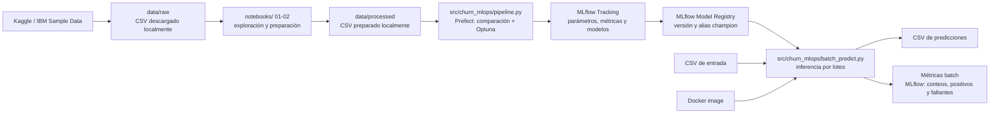

# Arquitectura de la solución

El pipeline selecciona el candidato por F1 medio de validación cruzada,
registra la versión en MLflow Model Registry y actualiza el alias `champion`.
La inferencia resuelve el alias, valida el esquema y emite métricas agregadas
del lote. No se guardan filas de clientes ni el CSV de salida como artefactos
de MLflow.

## Límites

- El flujo es batch; no expone un endpoint online.
- Las métricas de inferencia describen volumen, faltantes y distribución de
  predicciones. No miden desempeño real porque el proceso no dispone de
  etiquetas posteriores al período de predicción.
- Prefect, MLflow y la imagen Docker se ejecutan localmente para la
  demostración; no hay infraestructura productiva ni alertas configuradas.
